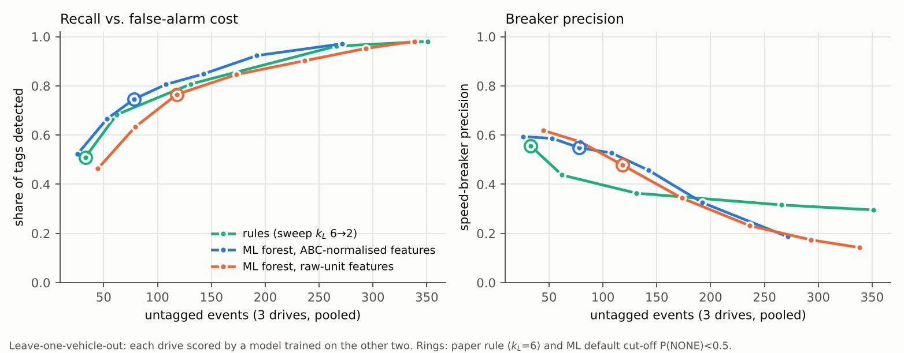
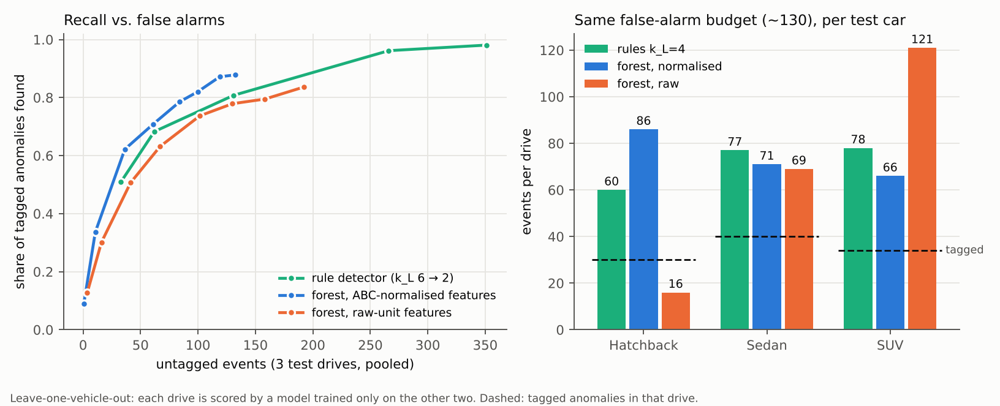

# edge_ml: offline analysis and model training

Run everything from this folder. The scripts read the raw drives from `../datasets/raw_drives/{hatchback,sedan,suv}.txt` and write to `results/`.

```
pip install -r requirements.txt
```

## Scripts, in pipeline order

| Script | What it does |
|---|---|
| `roadsense_analyze.py` | Parses a CoolTerm log and replays the firmware's trigger and rule classifier on the raw 100 Hz stream. Scores events against the tags and can tune parameters. Writes event, map and review CSVs and an HTML ride map |
| `eval_3vehicles.py` | Cross-vehicle evaluation for the paper: frozen parameters, tag matching, ABC vs fixed thresholds, GPS clustering of events across cars |
| `rs_features.py` | Same replay, plus the 21 ML features for each event window (raw and ABC-normalised) |
| `ml_experiment.py` | Event-filter forest with leave-one-vehicle-out evaluation, raw vs normalised. Writes `results/ml_summary.txt`, `ml_curves.json`, `ml_dataset.csv` |
| `make_ml_figure.py` | `results/ml_operating_points.png` |
| `export_model.py` | Trains the deployed forest on all three drives and writes `rs_ml_model.h` into both firmwares, plus `results/test_vectors.txt` for the C tests |
| `compare_firmware.py` | Checks that the firmware simulation output (`results/fw_*.txt`) matches the Python pipeline |
| `check_mirror.py` | Checks that `rs_features.replay_ml` produces exactly the same events as `roadsense_analyze.replay` |
| `wd_dataset.py` | Whole-drive dataset: 1.4 s windows every 0.2 s, labelled from the tags |
| `wd_experiment.py` | Whole-drive classifiers (forest, boosting, logistic regression) vs rules at matched false-alarm budgets |
| `wd_figure.py` | `results/wholedrive/wd_results.png` |
| `full_dataset.py` | Optional export of every 100 Hz sample and every 1 s window of each drive |

## Results

- [`RESULTS_ML.md`](RESULTS_ML.md): the event-filter forest and its ESP32 deployment
- [`RESULTS_wholedrive.md`](RESULTS_wholedrive.md): the whole-drive classifier
- `results/`: summaries, operating-point curves, figures, firmware simulation outputs



